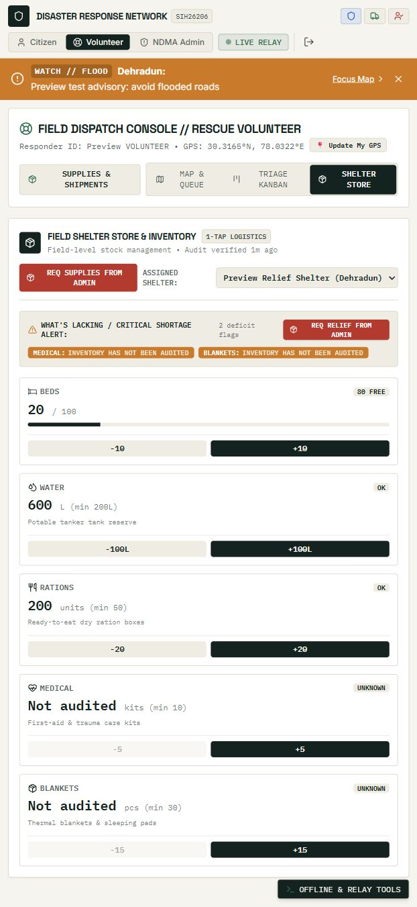
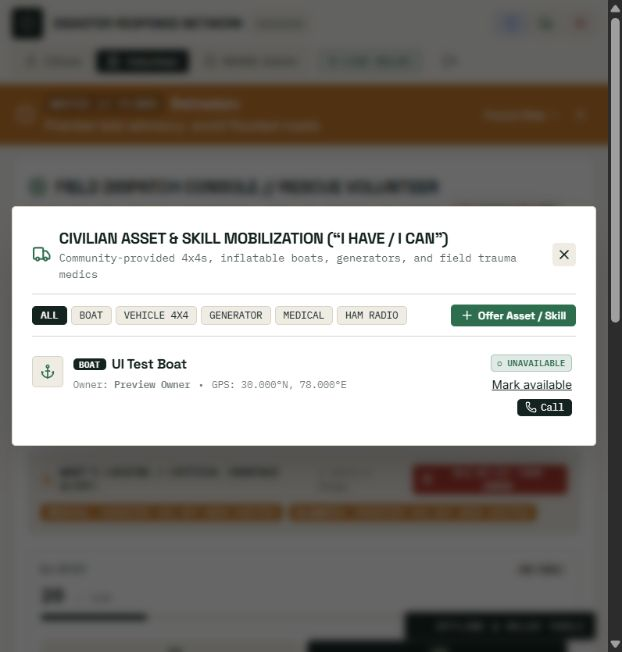

# Project audit and repairs — 9 October 2026

This audit reviewed the React UI, Express route handlers and middleware, Socket.IO access, Prisma persistence, offline queue, service worker, notification services, dependency locks and deployment setup. Confirmed defects were repaired in the working tree. It is a source review and local regression exercise, not a production penetration test or a guarantee that no defects remain.

## Repaired findings

| Area | Defect and resulting behavior |
| --- | --- |
| Authentication | Published/default JWT signing keys were usable; token role claims could outlive approval changes. Production now requires a private signing key, requests read current account permissions, and revoked responders are disconnected from private sockets. ADMIN self-registration is forbidden. |
| Volunteer permissions | Unapproved volunteers could reach operational actions. Field routes require administrator approval; administrators can approve/revoke access in the UI. Pending volunteers can refresh approval with progress and error feedback. |
| Privacy | SOS/pickup socket broadcasts and asset contacts could reach unrelated clients. Private broadcasts reach approved responders and the owner. Asset lists require authentication and restrict ordinary accounts to their own resources. Missing-person listings require sign-in. Health responses omit user totals. |
| Origins and proxy trust | Broad origin checks and unconditional proxy trust weakened the request boundary. CORS and socket handshakes use exact configured production origins; proxy trust is opt-in. Vite named tunnel hosts are opt-in. |
| Push delivery | Caller-controlled push URLs could target private/internal services. Registration and delivery now validate HTTPS endpoints against known push-provider hosts and bound send time. Persisted production VAPID credentials are required for push. |
| Input handling | Partial IDs, wrong JSON types, bad coordinates, oversized photos and invalid enum/date values caused crashes or incorrect updates. Routes validate IDs and mutation fields; JSON/photo/query sizes are bounded. Malformed JSON is 400, oversized JSON 413, unknown API routes JSON 404. |
| SOS lifecycle | Concurrent claims, terminal-state resets and improper citizen closure/reopen requests could corrupt dispatch. Assignment and state changes condition updates on their prior state; owner and responder checks apply. Citizen reopen is allowed only after resolution awaiting confirmation. |
| Shelter audits | Invalid capacity edits could partially update stock; concurrent deltas could overwrite each other. Audits and deltas now transact with events and retry serialization conflicts. New unmeasured medical/blanket inventory stays null rather than receiving fictional defaults. |
| Relief supplies | Concurrent pickups could overspend stock; queued timestamps could bypass cooldown; mismatched shipments could credit another shelter. Pickup/stock/shipment writes are transactional, cooldown uses server time, codes must match the item and shelter, replay keys respect ownership. Concurrent absolute stock edits no longer accumulate twice. |
| Offline authorization | Queued data could choose another user or bypass online validation/role checks. The authenticated account owns queued reports; provisioned relays have constrained permissions. Action and sync-log writes commit together, and repeated keys do not repeat effects. |
| SMS telemetry | Partial numeric strings were accepted and sync-log failure could leave partial changes. Syntax is strict and bounded; shelter/SOS changes commit with their log. Absolute shelter occupancy is calculated inside the transaction. |
| Hazard voting | Concurrent votes could lose confirmation counts and expanded relations could expose password hashes. Vote/count changes transact and responses select public user fields only. Self-confirmation is rejected. |
| Notification truthfulness | Simulated SMS/push could be reported as delivered. External delivery disabled/unconfigured reports zero delivered; simulation remains explicitly labelled. Region fan-out and zero-coordinate telemetry are handled consistently. |
| Landing page | Static incident/resource numbers, disconnected subscriptions and placeholder controls misrepresented functionality. Counts, markers, advisory and shelter cards now use API data; SMS uses the real phone-registration contract, push uses a shared subscription helper, unsupported controls were removed or replaced with actual information. |
| UI controls | Asset availability and missing-person status changes lacked usable controls; dashboard/modal failures looked empty. Controls now save through their routes; loading/error/retry states distinguish failures from empty data. Stock/shipment changes display the returned server state. |
| Account/session state | Role switches could retain another dashboard's state or flush another account's queue. Dashboard instances are keyed by account; queue reads/clears/flushes are account-scoped, flush tokens are pinned, and session changes stop further batches. |
| Offline durability | Storage failures could appear as successfully saved emergencies; failed actions could disappear during flushing. IndexedDB transaction completion is awaited, fallback/quota failures are reported, and only server-acknowledged actions are removed. Failed records remain available. |
| Camera and photos | Scanner startup/close races and oversized evidence caused failures. Camera lifecycle has cleanup guards; photos are compressed and use the same validated online/offline contract. Manual code entry remains available. |
| PWA caching | API/private responses and stale code risked inappropriate caching or broken first offline loads. API/auth traffic bypasses caches; production builds emit a versioned worker and manifest of JS/CSS assets, which are precached before activation. Tile caching is bounded and provider-scoped. Push clicks stay on this app's origin. |
| Build/startup | Automatic reset/seeding could destroy existing data or expose privileged demo credentials. Startup checks the existing DB; build only prepares/generates Prisma. Development DB setup creates a backup and refuses data-loss flags. Demo reset requires two explicit development flags. Production refuses known privileged demo passwords. |
| Dependencies | Known vulnerable dependency versions were present. Locks were updated and nodemon replaced with Node's watcher. Both final npm audits report zero known vulnerabilities. |
| Responsive navigation | The console header hid controls in a horizontal overflow at the tested narrow width. Navigation wraps and the brand is a keyboard-accessible button. Vite's fixed HMR port no longer breaks alternate preview ports. |

## Route coverage

| Route group | Checks exercised |
| --- | --- |
| `/api/health` | Public health, no private totals, consistent unavailable/unknown route responses. |
| `/api/auth` | Registration/login/profile, current DB role/trust, ADMIN registration rejection, approval/revoke, own location/safety, exact unique safety lookup. |
| `/api/sos` | Input validation, approval/ownership, verification, concurrent assignment, progression, cancel/resolve/reopen rules, private socket recipients. |
| `/api/shelters` | Concurrent deltas, idempotent replay, rollback on invalid audits, occupancy/capacity consistency, unknown resource preservation. |
| `/api/supplies` and shipment aliases | Stock edits, last-stock pickup race, server cooldown, key ownership, shipment mismatch, private pickup sockets, offline-log rollback. |
| `/api/hazards` | Photo contract, offline ownership, concurrent votes, selected user fields, self-vote prevention. |
| `/api/offline` | Auth/role boundaries, durable replay, failed-action retention, strict SMS syntax and atomic persistence. |
| `/api/assets` | Authentication, owner-only ordinary listings, responder suggestions, ownership on availability updates, strict coordinates. |
| `/api/missing-persons` | Public report creation, authenticated listing, responder status update. |
| `/api/alerts` | Admin create/deactivate/delete, deletion conflict, custom telemetry validation, zero coordinates. |
| `/api/registry` | Correct phone contract, push-host rejection, public stats/VAPID endpoints. |

These checks exercise representative valid, invalid, unauthorized and concurrent paths. They are not exhaustive coverage of every combination or every UI state.

## Verification results

- Backend: `npm test` — **18 passed, 0 failed**, using a disposable SQLite DB, loopback HTTP/WebSocket server, mocked weather and disabled external delivery.
- Frontend: `npm test` — **6 passed, 0 failed**, covering queue ownership, quota failures, IndexedDB open/commit failures, acknowledgments, offline/logout preservation and account changes during flushing.
- Frontend: `npm run lint` — **0 errors, 0 warnings**.
- Frontend: `npm run build` — successful; entry JS is approximately 531 KB minified / 161 KB gzip. Vite still warns about the entry chunk exceeding 500 KB.
- Dependency checks: backend and frontend `npm audit` — **0 known vulnerabilities** at audit time. This is an advisory lookup, not a security certification.
- Browser: isolated demo database; citizen safety update and manual supply claim, volunteer inventory increment, admin approval controls, missing-person reporting with optional age/status updates, asset registration/availability, public landing data and narrow console layout were inspected. GPS/camera permission prompts, real SMS and real push delivery were not exercised.
- Existing database: compared every original field/row with the pre-update backup across **15 tables**; all preserved. Schema setup adds offline replay keys and removes invented resource defaults for new rows.

Backup kept locally and ignored by Git: `backend/backups/before-schema-1791534233700.db`. A prior backup is also retained. Backups contain personal data and require the same access controls as the application DB. Browser actions ran against disposable fixtures, not this database.

## Remaining deployment and product work

1. Configure private production secrets, exact frontend origins, HTTPS/WSS, durable database storage and reviewed provider-specific migrations. The PostgreSQL path, hosting configuration and reverse-proxy settings were not deployed or tested here. Never reuse the former published signing key; rotate deployment credentials if it was used. Existing privileged demo accounts must be removed or securely reprovisioned before production startup.
2. Configure and test persistent VAPID keys, Twilio and live weather credentials. Simulations are available but real deliveries and upstream failure/retry behavior need provider testing. Phone enrollment currently lacks SMS ownership verification, unsubscribe/consent management and delivery receipts.
3. Browser tokens and queued payloads remain in device storage. Shared devices need an explicit retention/encryption policy; production account security still needs verified identities, password recovery, session revocation and stronger administrator authentication. API authorization is enforced even if a cached UI is shown while disconnected.
4. Supply QR strings identify inventory; they do not prove physical pickup or shelter staff approval. Cooldown is per account, so stronger identity and supervised/signed pickup flows are required before using this as fraud-resistant distribution accounting.
5. Public hazard reports expose submitted incident locations/photos. Signed-in missing-person reports and exact safety lookup still disclose sensitive information to users with sufficient knowledge. Decide consent, retention, report moderation, who can view each field and abuse controls before real deployment. Community votes do not prevent Sybil accounts.
6. Global rate limits use process memory and are shared by users behind the same IP. Large deployments need a shared store, account-aware abuse controls, socket connection/message limits and load tests. Public list endpoints also need pagination/retention policies for large datasets.
7. Existing stock values that came from the old automatic defaults were deliberately preserved; field teams should re-audit them. New unknown quantities are shown as unknown. The shelter GREEN status describes the configured occupancy/resource rules, not physical safety certification.
8. Large frontend dependencies still need further performance tuning for low-end devices. Test production service-worker upgrades and genuine offline reloads on target browsers, along with physical camera scanning, denied GPS permissions and poor network conditions. Browser UI verification used the dev preview; production worker installation was checked through its built manifest/code, not a full device matrix.
9. The risk engine is threshold-based and demonstration telemetry is not a calibrated prediction or an official warning feed. Real agency/sensor integration, operational incident drills, observability, backup restoration and disaster-response load testing remain outside this local audit.

See [deployment guide](deployment_guide.md) and the README for safe setup. No production deployment, external alert broadcast or real-data reset was performed.

A later [second audit](SECOND_AUDIT.md) adds direct routes, operator assignment, complete rescue progression and consistent statistics. Its validation results supersede the counts in this first-pass report.
