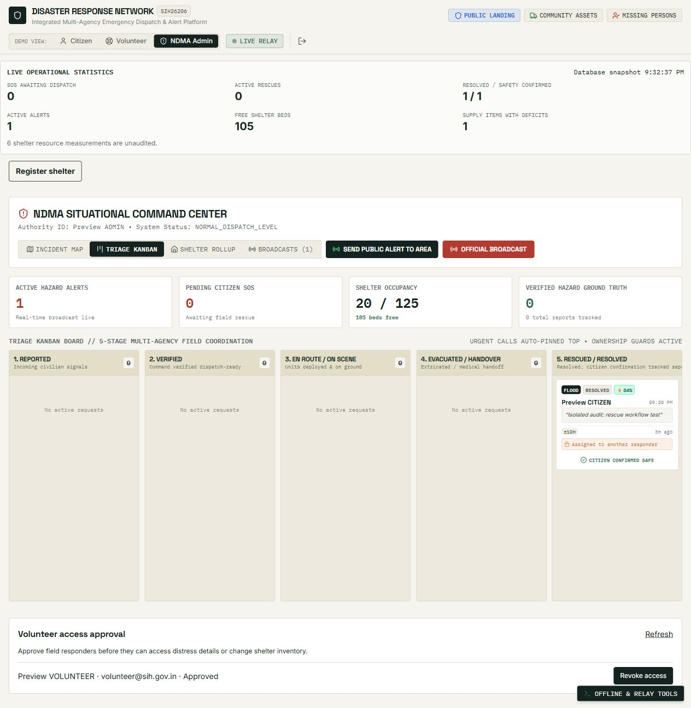

# Second audit: routes, three-role workflows, security and SIH26206 alignment

Audited on 9 October 2026. This pass builds on [the first audit](PROJECT_AUDIT.md). The application calls its operator role `ADMIN`; field responders are approved `VOLUNTEER` accounts. Changes remain in the working tree.

## Outcome and boundaries

Fixed additional dispatch, navigation, live-update, statistics and validation defects. Verified a complete rescue across three simultaneously signed-in browser sessions connected to one isolated backend: citizen report → operator verification → assignment to a selected volunteer → arrival → evacuation → medical handover → resolution → citizen confirmation. Each console updated without a reload. Registering another shelter in the operator console immediately updated the citizen shelter list and free-bed total.

This is a source review and local regression audit, not a penetration-test certificate or a claim that no vulnerabilities remain. Production hosting, PostgreSQL, external SMS/push delivery, physical QR scanning, real emergency operations and device permissions were not comprehensively tested. The existing application database was not reset or used for browser mutations. Its persisted ticket states were inspected using aggregate counts only: EN_ROUTE, ON_SCENE and VERIFIED; these are supported by the repaired UI.

## Additional findings and fixes

| Finding | Effect | Fix |
|---|---|---|
| Volunteer dispatch queue and map used obsolete `IN_PROGRESS` | Assigned tickets disappeared from the dispatched list; progress buttons were missing | All four active rescue states stay visible; the map and queue expose the next permitted stage |
| Volunteer buttons attempted to claim PENDING tickets | The API correctly rejected the action, making the option appear broken | Dispatch becomes available after operator verification |
| Verification, assignment and deactivation buttons omitted the JSON body | Global request validation could reject otherwise valid UI actions | These actions send `{}` or the required assignment data |
| Operator assignment only assigned the caller | There was no way to send a selected volunteer from the control room | Approved-volunteer selector plus `volunteerId` support; ordinary volunteers cannot assign others; invalid/unapproved targets are rejected |
| Direct resolution bypassed arrival | A dispatched responder or operator could resolve an unvisited ticket | Resolution requires ON_SCENE, EVACUATED or HANDED_OVER_TO_MEDICAL |
| Citizen descriptions collapsed later stages into “en route” | Evacuation and handover were misrepresented | Each lifecycle stage has its own description |
| Citizen did not listen for new owned SOS events | Reports from another device/offline ingestion could be missing | Own `sos:created` events are inserted, with ID deduplication |
| Dashboard cleanup removed every listener for an event | Unmounting one consumer could silence another | Cleanup removes only that consumer's handler; regression exercises multiple consumers |
| Operator inserted both socket and HTTP broadcast responses | Duplicate cards and inflated alert totals | Response/event upserts deduplicate by ID |
| Restock event shape did not match banner links | Shelter ID and message could be missing | Events carry explicit `shelterId` and message |
| Permission changes forcibly disconnected sockets | Socket.IO server disconnects did not reconnect automatically | Refresh current account permissions and reconnect/recreate the socket; cancelled sessions cannot reconnect |
| Asset/missing-person changes did not reach open views | Other consoles retained stale records | Scoped change notifications and exact-listener refresh; asset suggestion caches invalidate on availability changes |
| New shelters had no operator creation form and were not inserted into other lists | Backend creation existed but was unwired in the UI | Operator registration form, broadcast and shelter upserts in all consoles |
| Independently counted dashboard metrics | Different roles could use different definitions | Authenticated, consistent database snapshot at `/api/operations/summary`; events, reconnect, online and 30-second polling refresh it |
| Denied GPS fell back to a geographic map centre in SOS/hazard submissions | False incident coordinates could be submitted as a location | No report-location fallback; use known coordinates or required manual inputs; unavailable distance is explicit |
| An application SMS payload was addressed to 112 | No evidence that the national number accepts this project's parser | Optional configured operator gateway; otherwise Messages requires the user to enter a gateway destination |
| Peer verification radius differed from local PRD; trusted citizen could count as authority | Remote ordinary votes and authority escalation in tier calculation | Citizen location within 300 metres required; trusted authority restricted to operators/approved volunteers; responders can review remotely |
| Asset suggestions were unrestricted geographically | “Nearby” suggestions could refer to distant resources | Suggestions limited to 2 km; availability changes trigger refresh |
| Creation coerced malformed capacity/occupancy | Partial strings or fractions could become valid-looking shelter data | Strict integer capacity and occupancy within capacity |
| Public registry advertised three channels regardless of provider setup | Unconfigured delivery appeared armed | Return configured channel capabilities, refresh registration totals live, label registered devices correctly and show unavailable counts |
| Direct URLs/back/forward were not connected to views | `/login` displayed the landing page; navigation was not shareable | URL-aware navigation, history handling, role-specific route guards and an explicit unknown-page view |
| Unverified map boundary was labelled official SOI compliance | UI implied a verified provenance/compliance claim | Reference overlay label; authoritative boundary verification remains a deployment requirement |
| Unmeasured resources were described as adequate | Defaults could imply verified availability | Unknown quantities stay explicit; public cards and rollup describe reported limits rather than certified readiness |
| Client login errors logged full Axios errors | Console diagnostics could contain request credentials | Login diagnostics log status only |

## Route coverage

The generated [route inventory](ROUTE_INVENTORY.md) contains **77 mounted HTTP method/path pairs**, including compatibility aliases. The inventory regression maps **75 literal frontend API calls** to backend routes, with **zero unmatched calls**. This checks route connectivity, not exhaustive branch coverage. Variable-built supply/shipments URLs and offline queue paths are reviewed in the workflow tests/source separately. The server starts in integration tests, which also detects undefined route handlers.

Direct frontend routes now include `/`, `/login`, `/register`, `/alerts`, `/console`, `/citizen`, `/volunteer` and `/operator`. Role-specific console URLs check the signed-in role. API middleware remains the authorization boundary. Existing `#landing` and `#console` links continue working. Production hosts must serve the SPA entry for those paths; the supplied Vercel configuration already includes that rewrite.

## Shared statistics: definitions and evidence

SIH26206 does not supply a numerical dataset or target KPI in the retrieved statement. The values below describe this deployment's records; they are not national disaster statistics, measured prediction accuracy or official SIH targets.

| Metric | Definition |
|---|---|
| SOS awaiting dispatch | PENDING + VERIFIED |
| Active rescues | EN_ROUTE + ON_SCENE + EVACUATED + HANDED_OVER_TO_MEDICAL |
| Resolved / safety confirmed | RESOLVED tickets / subset whose citizen confirmed resolution |
| My assigned work | Active rescue tickets assigned to the requesting account |
| Active / critical alerts | Active, non-deleted alert rows / subset with CRITICAL severity |
| Free shelter beds | Sum of `max(0, capacity − currentOccupancy)` over active shelters |
| Shelter occupancy and capacity | Separate sums over active shelters; never added to supplies |
| Supply items with deficits | Active-shelter supply items with fulfilled quantity below needed quantity; count of items, not a sum of unlike units |
| Unaudited measurements | Null fields among water, rations, medical kits and blankets; never treated as zero or adequate |
| Available assets | Available registered assets; ordinary accounts see their own count, approved responders see the response network |
| Hazard review | RED = verified; GREY/AMBER = under review; RESOLVED and DISPUTED separate |
| Missing persons | Reports with MISSING status; no identity matching or biometric claim |

Citizens and unapproved volunteers receive their own SOS totals, not other citizens' distress data. Approved volunteers and operators receive network totals. Global public operational counts contain no contact details. `asOf` identifies the database snapshot; failed refreshes show stale/unavailable feedback.

Browser fixture evidence: one report changed from awaiting dispatch `1`, to active rescue `1`, to resolved/confirmed `1 / 0`, then `1 / 1`. Starting capacity 100 and occupancy 20 gave 80 free beds. An additional empty 25-bed shelter gave 105 free beds in the citizen and operator consoles. These are disposable test records.

## SIH26206 comparison

The official [SIH 2026 problem-statement page](https://sih.gov.in/sih2026PS) returned HTTP 403 during research. A [community SIH26206 archive](https://sihone.pages.dev/ps/26206) and [independent problem-statement snapshot](https://github.com/harshgounder/sih-2026/blob/main/data/SIH_2026_Problem_Statements.md) identify **AICTE, Software, Student Innovation, Disaster Management**. The archived description covers risk mitigation and planning/management before, during and after disasters. The archive's proposed AI/IoT architecture is third-party advice, not an official mandatory specification. Alignment below is provisional until the official statement is accessible.

| Area | Current implementation | Gap / qualification |
|---|---|---|
| Before: preparation and risk mitigation | Registered alert recipients, map views, shelters/resources, weather threshold evaluation | Risk engine is a rule-based demonstration, not calibrated ML; official agency/sensor feeds are not integrated |
| During: coordinated response | Citizen SOS, operator verification/dispatch, volunteer progress, triage, crowd reports, live counts | Identity assurance, field operating procedures and emergency load drills still required |
| During: shelter and relief management | Shelter creation/audits/deltas, capacity alerts, nearest alternative, stock requests, shipments and pickup records | Different supply units and bulk shelter inventory are separate ledgers; no automatic conversion or physical delivery proof |
| Connectivity resilience | Account-scoped local queue, server replay keys, SMS-format parser, reconnect refresh | Simulation of relay/SMS formats; no real radio mesh or inbound telecom gateway |
| After: follow-up and recovery | Citizen rescue confirmation/reopening, safety lookup, missing-person statuses and operational records | No full rehabilitation programme, outcome study or post-disaster impact analytics |
| Community resource mobilisation (local PRD stretch) | Registered available assets and responder suggestions within 2 km | Availability depends on owner updates; no reservation/dispatch contract for assets |
| Missing-person matching (local PRD stretch) | Searchable bulletin and responder-confirmed located/shelter-safe statuses | Shelter intake lists, similarity scoring and report-to-intake matching remain unimplemented |
| Automated safe routing | Hazard-aware map and external directions | Local PRD explicitly defers automated routing; no obstacle-aware turn-by-turn route engine |
| Advanced technology | Clearly labelled weather/IoT-style simulations | No trained AI model, live drones/satellites, production sensors, real mesh or facial recognition; local PRD defers these |

The local [PRD](prd.md) is a product plan, not an official SIH requirement list. The rescue and live-statistics demo was verified; its “under one minute” onboarding goal was not timed with real users. Camera capture/gallery inputs are not proof of authenticity, GPS can be spoofed, and vote thresholds do not prove ground truth.

## Security review and remaining work

Rechecked authentication/current database roles, approval and ownership boundaries, JSON/type/size validation, JWT configuration, exact CORS checks, push destination restrictions, private socket rooms, transaction races/replay keys, stock/cooldown accounting, image contracts, cache controls, production secret/demo guards and dependency advisories. Existing protections from the first audit continue to pass. Anonymous clients cannot join authenticated citizen rooms; private SOS and pickup events reach only the owner and authorized responders.

Unresolved production requirements remain concrete:

1. Administrator MFA, account identity verification, password recovery, server-side session revocation and retention controls for browser tokens/offline reports.
2. Verified phone ownership, consent/unsubscribe, delivery receipts and real provider failure/retry testing. Configured capability is not confirmed delivery.
3. Missing-person consent/access policy, moderation and deletion; GPS anti-spoofing and account-abuse controls. Community accounts can collude. Safety lookup reveals limited status to users who know matching details.
4. QR pickup staff authorization or signed supervised redemption, stronger beneficiary identity and reconciliation of real deliveries. An inventory QR identifies stock; it does not prove physical pickup.
5. Pagination/retention, shared rate-limit storage, socket message/connection limits, multi-instance event infrastructure, load testing and observability.
6. Reviewed PostgreSQL migrations, private production secrets, exact origins, HTTPS/WSS, persistent storage, backup restoration drills and authoritative map-boundary provenance. None was deployed in this audit.
7. Low-end device/offline service-worker upgrade tests; the entry bundle still exceeds 500 KB minified. Development browser testing is not a full production/device matrix.

## Final validation

- Backend `npm test`: **22 passed, 0 failed** (isolated database and HTTP/WebSocket server, external delivery disabled).
- Frontend `npm test`: **9 passed, 0 failed** (offline storage, ownership/progression, exact socket cleanup and direct routes).
- Frontend `npm run lint`: successful, no reported diagnostics.
- Frontend `npm run build`: successful; entry approximately **533.21 KB minified / 161.91 KB gzip**, with the existing chunk-size warning.
- Backend and frontend `npm audit`: **0 known vulnerabilities** on the audit date. Advisory scans do not certify application security.
- Browser: three isolated role sessions, full rescue with live citizen descriptions/counts, live shelter creation, wrong-role route denial, unknown-page feedback and browser back navigation.

No external alerts were sent and no production deployment or real-data reset was performed. Temporary test servers/databases are removed after verification. The regular development app remains on port 5177.

## UI simplification follow-up — 10 October 2026

The citizen dashboard now opens on shelter finding with a prominent help request button; volunteer work opens on the signed-in responder's assignments; operator work opens on requests needing verification or dispatch. Shared tabs separate maps, supplies, alerts and team approval. Three main counts replace the repeated metric panels; additional statistics, triage boards, weather/demo tools and contact details are expandable. Operator shelter cards replace the large rollup table, and supply actions now open the selected shelter's records. Emergency forms use clearer language and scroll on phones. Saved/manual incident coordinates remain explicit.

Validation: frontend **10/10** tests, backend **22/22** tests, lint without diagnostics, production build successful, and whitespace checks clean. The build retains the documented entry chunk warning (531.59 KB minified / 161.63 KB gzip). The route inventory reports 77 mounted route pairs, 76 literal client calls and zero unmatched literal calls; variable dispatch paths were reviewed and exercised in the browser.

Browser verification used a disposable SQLite database and separate role origins, with external messaging disabled. Citizen request → operator verification → approved volunteer assignment → arrival → evacuation → medical handover → resolution → citizen confirmation completed with live counters. Map tabs, region controls, supplies modals, safety tools, alerts and team navigation were checked. Phone layouts were checked at 390 px across all roles and at 320 px for the operator; constrained dashboard containers and wrapping controls were corrected. Old session tokens from the prior disposable server correctly produced 401 sign-outs; no new UI runtime errors appeared after fresh demo sign-in. This does not replace a physical-device test matrix.

Previews: [citizen](ui-simple-citizen.png), [volunteer](ui-simple-volunteer.png), [operator](ui-simple-operator.png), [citizen phone](ui-simple-mobile.png). These screenshots show disposable test records, not production data.
